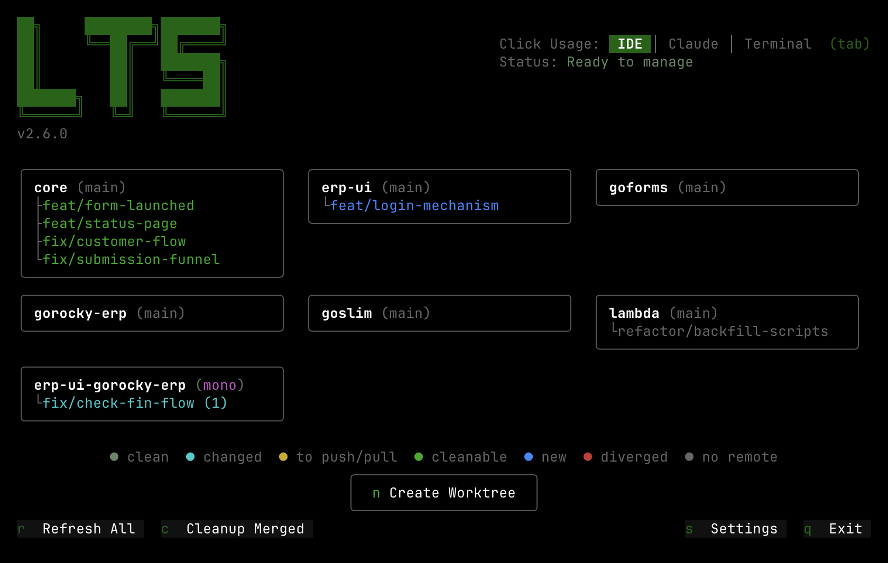
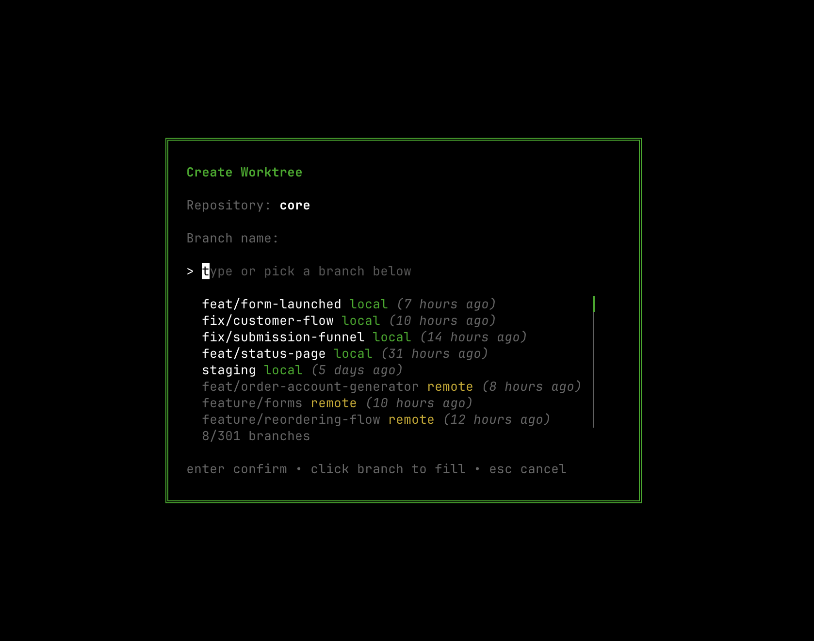
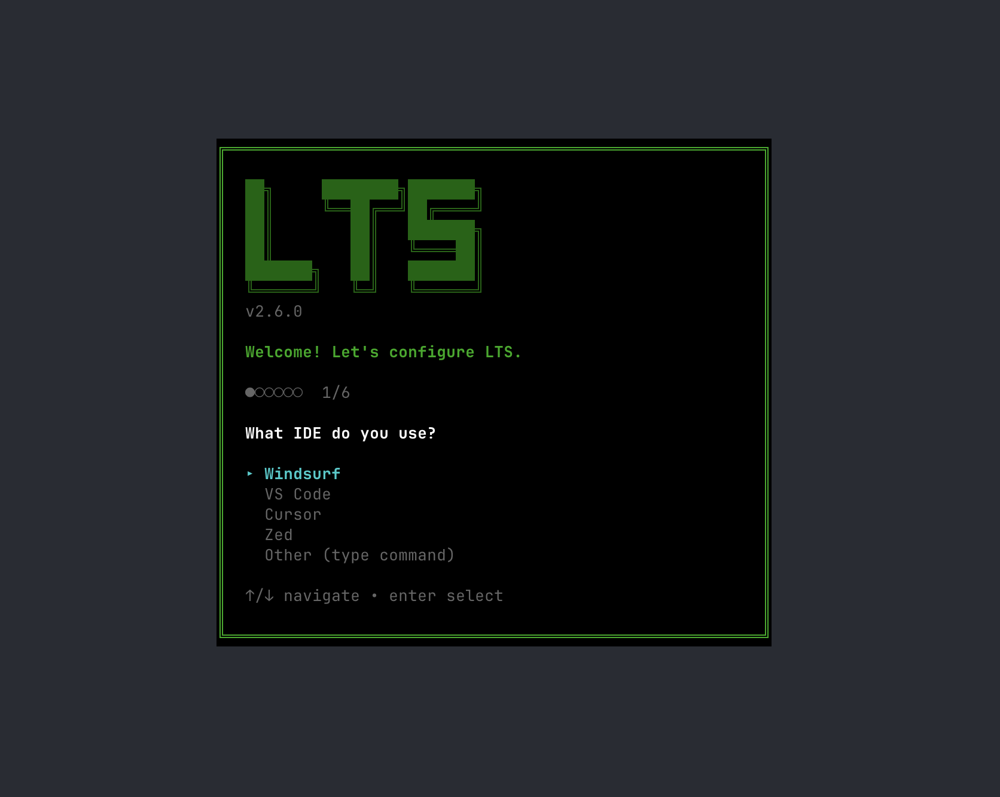

# LTS — Led's Tree Script

A modern terminal UI — and, since v3.2, a scriptable CLI for humans, scripts and AI agents — for managing git worktrees. Built with Go, Bubble Tea, Lip Gloss and Cobra.


```
██╗     ████████╗███████╗
██║     ╚══██╔══╝██╔════╝
██║        ██║   ███████╗
██║        ██║   ╚════██║
███████╗   ██║   ███████║
╚══════╝   ╚═╝   ╚══════╝
```

## Screenshots

<table>
  <tr>
    <td></td>
    <td></td>
    <td></td>
  </tr>
  <tr>
    <td align="center"><sub>Main View</sub></td>
    <td align="center"><sub>Create Worktree</sub></td>
    <td align="center"><sub>Setup Wizard</sub></td>
  </tr>
</table>

## Features

- **Scriptable CLI** — `lts ls`, `status`, `create`, `rebase`, `rename`, `delete`, `cleanup-merged`, `open`, `watch`, `prune`, `pr`, `hibernate`, `config` and more, with `--json` everywhere, stable exit codes, `--dry-run` on everything that changes state, suggest-only "did you mean", and no prompts without a terminal ([CLI](#command-line-interface))
- **Built for a human and an agent at once** — the TUI and the CLI share per-repo locks, so neither can act on a repo the other is changing; `lts watch` streams events for orchestrators
- **AI-agent ready** — a Claude Code plugin (skills + session hooks), `lts skill install` for any setup, and `lts help agents`, a single page that teaches an agent the whole contract ([AI agents](#ai-agents))
- **One-click worktree creation** — Stash, pull, branch, copy `.env`/`.mcp.json`, install deps, and generate workspace in one step (per-repo install toggles included)
- **Multi-repo worktrees** — Create worktrees across multiple repos at once for monorepo-like workflows, each repo using its own basis branch and package manager
- **Click to open** — Open any worktree directly in your IDE, AI CLI, or terminal
- **Tmux sessions per worktree** — With the tmux multiplexer enabled, AI CLI and Terminal opens share one persistent session per worktree (AI pane + shells, configurable layout); reopening reattaches, so AI conversations survive closing the terminal
- **Clone from GitHub** — With the [GitHub CLI](https://cli.github.com) installed and authenticated, press `c` (or click the "(c) Clone a Repo" tile) to browse and clone any repo you can access, sorted by recency
- **Create PRs** — Pushed, unmerged worktrees on GitHub repos gain a "Create PR" action (context menu / Explorer `g`) that opens the prefilled compare page in your browser, based against the repo's basis branch; if a PR already exists it opens that instead
- **Themes** — Ten built-in color themes with a live-preview **Theme Studio** (Settings → Preferences → Theme, then enter): LTS originals — Classic LTS, Led There Be Light, Jela My Love, Photosynthesis, Lights Out — plus Dracula, Nord, Gruvbox Dark, Catppuccin Mocha and Solarized Light. Browsing re-skins the whole screen instantly; a synthetic repo shows every worktree status, the action strip, a Board card and the status bar so you see exactly what you're choosing
- **Auto package manager** — The default "auto" mode detects each repo's package manager (corepack `packageManager` field, then lockfiles with pnpm > bun > yarn > npm preference), so mixed pnpm/npm setups need zero configuration; per-repo overrides still win. Settings shows a yellow ⚠ inline the moment any tool setting points at a program that isn't installed, and Diagnostics inventories every package manager found with its version
- **Per-repo setup script** — An optional command (chainable with `&&`) that runs inside every new worktree of a repo after the package install, e.g. `pnpm --filter @gorocky/shared-types build`; failures log without blocking the worktree
- **Mono group convert & split** — Forgot to make a worktree part of a mono group? The worktree context menu's "Add to Mono Group" picks partner repos (adopting their existing same-branch worktrees, or creating fresh ones) and relocates everything into the group layout via `git worktree move` — uncommitted work rides along. "Split Mono Group" reverses it per constituent: keep as a single-repo worktree, or delete it (only offered when its status is safe — anything unpushed or uncommitted is locked to keep)
- **Hide repos** — Hide unwanted repo-shaped folders (`.nvm`, `.oh-my-zsh`) from the board via the repo context menu; a Show Hidden Repos toggle brings them back grayed out, and hiding the clutter restores the empty-state folder suggestions
- **Personal-taste toggles** — The launch greeting, background worktree size scanning (the SIZE column), the Board/Explorer layout, and the whole GitHub integration each have a switch in Settings → Preferences, so LTS stays out of your way where you want it to
- **Hibernate repos** — Free disk space by deleting a GitHub-synced repo locally, gated behind a safety audit (every branch pushed or merged, no stashes, everything clean); untracked `.env` files are backed up first and offered back on re-clone
- **Branch status at a glance** — Color-coded cards show clean, changed, diverged, merged, and new branches, plus tmux-session and busy indicators
- **Rebase, rename, delete, clean modules, kill sessions** — Manage worktrees from context menus (Board) or the action strip (Explorer) without leaving the TUI
- **Two layouts** — Board (repo cards) or Explorer (repo sidebar + worktree table with full status text, age, and tmux columns); switch with `shift+tab`
- **Per-repo concurrency** — Operations lock only the repos they touch; rebase one repo while another creates, with live logs for everything
- **Auto-maintenance** — Optionally clean `node_modules` and kill idle tmux sessions by age, on startup and hourly
- **Storage awareness** — A disk gauge in the header (green/yellow/red by fullness) and an Explorer SIZE column showing each worktree as `code+node_modules` (e.g. `300M+1.1G`), scanned in the background
- **Setup wizard** — Walks you through configuration on first run; tweak anytime in Settings (Preferences / Workspace / Worktrees / Diagnostics)

## Platform Support

| OS | Architecture | Pre-built Binary | Notes |
|----|-------------|-----------------|-------|
| macOS | Apple Silicon (arm64) | Yes | Full support — iTerm2, Terminal.app via AppleScript |
| macOS | Intel (amd64) | Yes | Full support |
| Linux | x86-64 (amd64) | Yes | Uses `x-terminal-emulator` as default terminal fallback |
| Linux | ARM64 (arm64) | Yes | Same as Linux x86-64 |
| Windows | — | No | Use [WSL](https://learn.microsoft.com/en-us/windows/wsl/) |

Cross-platform terminals with native flag support: Ghostty, WezTerm, Alacritty, Kitty.
macOS-specific terminals: iTerm2, Terminal.app (via AppleScript).

## Installation

Requires Git.

```bash
curl -fsSL https://raw.githubusercontent.com/led-slzr/lts/main/install.sh | bash
```

The installer downloads a pre-built binary for your platform. If no pre-built binary is available, it falls back to building from source (requires [Go 1.21+](https://go.dev/dl/)).

<details>
<summary>Manual build from source</summary>

```bash
git clone https://github.com/led-slzr/lts.git
cd lts
go build -o ~/.local/bin/lts .
```

</details>

## Uninstall

```bash
lts skill uninstall             # Remove agent skills/hooks (if installed)
rm -f ~/.local/bin/lts          # Remove binary
rm -rf ~/.config/lts            # Remove global config
```

To also remove per-workspace state, delete `.lts.conf` and `.lts-locks/` from each workspace directory where LTS was used.

## Usage

```bash
lts                    # open the TUI in the current directory
lts --dir ~/projects   # open the TUI in a specific workspace
lts <command> [flags]  # run a CLI command (see below)
lts help               # list commands; lts help <command> for details
lts --version          # print version
```

On first run, the TUI launches a setup wizard to configure your preferences. You can change these anytime via the Settings UI (`s`) or `lts config set`.

## Command-line interface

Every TUI capability that matters for day-to-day work is also a command. Commands find the workspace (the folder that contains your repos) from `--dir`, then `$LTS_DIR`, then the current directory — running from inside any repo or worktree works.

| Group | Command | What it does |
|---|---|---|
| Inspect | `lts ls [repo...]` | Repos and their worktrees (fast — no git status) |
| | `lts status [target] [--all] [--fetch]` | State, ahead/behind, changed files, delete risk |
| | `lts path <target> [--member repo]` | Print only the worktree path — `cd "$(lts path feat/x)"` |
| | `lts config [list\|get\|path]` | Every setting with its value, default and source |
| Change | `lts create <branch> -r repo[,repo]` | Worktree for one repo, or a mono group across several (`--basis`, `--lts-root`, `--no-install`, `--reuse`, `--open`, `--dry-run`) |
| | `lts refresh [repo...]` | Fetch and fast-forward each repo's basis branch |
| | `lts rebase [target] [--refresh]` | Rebase onto the basis branch — a mono group rebases every member (`--member` for one); conflicts abort cleanly (exit 6) |
| | `lts open [target] --ide\|--ai\|--terminal` | Open a worktree exactly like clicking it in the TUI (workspace file, AI CLI, shell; tmux sessions when enabled) |
| | `lts rename [target] <new> [--remote]` | Rename branch, folder, workspace file and tmux session |
| | `lts pr [target] [--print]` | Open (or print) the existing PR or a prefilled compare page |
| | `lts config set KEY VALUE [-r repo]` | Validated settings change (same rules as the Settings screen) |
| Remove | `lts delete [target]` | Guarded delete: `--yes` for safe states, `--force --yes` for unsaved work |
| | `lts cleanup-merged` | Delete every merged, clean worktree (`--dry-run`, `--yes`, `--remote`) |
| | `lts clean-modules [target]` | Remove `node_modules` and report the space freed |
| | `lts prune [repo...]` | Forget worktrees whose folder was deleted by hand (branches kept) |
| | `lts hibernate <repo>` | The TUI's Hibernate Repo: audit, `.env` backup, delete local copy (`--dry-run`; `--confirm <repo>` without a terminal) |
| Inspect | `lts watch [--json] [--status]` | Stream events: worktree added/removed, busy/idle, missing, state changes |
| Agents | `lts help agents` | The contract for AI agents and scripts |
| | `lts skill install\|print` | Install the agent skills / print them for `AGENTS.md` |
| | `lts hook <event>` | Claude Code hook handlers |

**Targets.** A worktree can be named by branch (`feat/login`), folder (`feat-login`), id (`core-lts/feat-login`, shown by `lts ls`) or path; omit it to use the worktree you are in. Add `-r <repo>` when a branch exists in several repos.

**Contract for scripts.**

- Results go to **stdout**, progress to **stderr**. `--json` prints one object: `{"schema_version":1,"ok":true,...}` or `{"ok":false,"error":{"code","message","hint","suggestions"}}`.
- Nothing prompts when stdin isn't a terminal (or with `--no-input` / `CI`): a missing confirmation exits 4 and the hint names the flag.
- Typos produce suggestions (`lts craete` → `create`, `-r apii` → `api`) and are never auto-applied.
- Repos are locked per process: if the TUI or another command is busy with a repo, commands fail with code `busy` — or wait with `--wait=2m`.

| Exit | Meaning |
|---|---|
| 0 | success |
| 1 | error (including `busy`) |
| 2 | usage error |
| 3 | not found / ambiguous (with suggestions) |
| 4 | refused by a safety guard — needs `--yes` / `--force` |
| 5 | partial failure |
| 6 | rebase conflict (aborted, changes restored) |
| 7 | already exists (`create --reuse` returns it instead) |
| 130 | interrupted |

```bash
# start a task, preview first
lts create feat/login -r core --dry-run
cd "$(lts create feat/login -r core --reuse -q)"

# one branch across two repos
lts create feat/integration -r core,erp --basis erp=dev

# what needs attention?
lts status --all --fetch --json | jq '.worktrees[] | select(.status.dangerous_to_delete)'

# ship and clean up
git push -u origin feat/login && lts pr --print
lts cleanup-merged --dry-run && lts cleanup-merged --yes
```

## AI agents

LTS is built to be driven by agents that have never seen it: `lts help agents` explains the layout, the output contract, exit codes, safety rules and orchestration patterns in one page, and every command's `--help` lists examples and exit codes. `lts help --json` dumps the full command spec.

**Claude Code plugin** (skills + hooks, updates with the repo):

```
/plugin marketplace add led-slzr/lts
/plugin install lts@lts
```

| Skill | For |
|---|---|
| `lts:context` | Auto-loaded in LTS workspaces: layout, contract, safety rules |
| `lts:start` | Start a task in a new worktree (single repo or mono group) |
| `lts:finish` | Push, open the PR, delete the worktree after merge |
| `lts:tidy` | Find merged / stale worktrees and clean up — dry-run first |
| `lts:sync` | Refresh repos and rebase worktrees, reporting conflicts |

The plugin's `SessionStart` and `SubagentStart` hooks add a short LTS summary to every session and subagent — which worktree it is in, its status, the other worktrees, and the safety rules — so orchestrators and their workers know where they are without being told. Outside LTS workspaces they print nothing.

**Without the marketplace:** `lts skill install` writes the same skills to `~/.claude/skills/lts-*` and adds the hooks to `~/.claude/settings.json` (backed up first; `--no-hooks` for skills only; `lts skill uninstall` reverses it). `lts skill print` emits the skills as Markdown for `AGENTS.md`-style instructions in other agents. `--worktree-hook` additionally routes Claude Code's own isolated worktrees through LTS (env files, dependencies, setup script, LTS layout) — it steps aside whenever the repo's main checkout is dirty or off its basis branch — and removes them again when Claude Code is done, keeping any that hold unsaved work.

**TUI + agents together:** the TUI and every CLI command take the same per-repo locks, so while you rebase `core` in the TUI an agent's `lts delete` on `core` gets `busy` (and the TUI refuses actions on a repo an agent is working on, naming who holds it).

## Keyboard Shortcuts

| Key | Action |
|-----|--------|
| `Tab` | Cycle click usage: IDE → AI CLI → Terminal (remembered across launches, like the layout) |
| `Shift+Tab` | Switch layout: Board ↔ Explorer |
| `↑↓←→` / `hjkl` | Navigate (Explorer: sidebar/sheet; Board: scroll) |
| `Enter`, `b`, `g`, `m`, `p`, `d`, `x` | Explorer selected row: open, rebase, create PR, rename, purge modules, delete, kill tmux session |
| `n` | Create new worktree (Explorer: pre-seeded with the selected repo) |
| `c` | Clone a repo from GitHub (requires `gh`) |
| `r` | Refresh all repos |
| `Shift+C` | Cleanup merged worktrees |
| `l` | Clear log panel |
| `s` | Open settings |
| `q` / `Ctrl+C` | Quit |
| `Esc` | Close modal / clear selection / focus Explorer sidebar |

## Mouse

| Action | Result |
|--------|--------|
| Hover card | Border highlights white |
| Hover worktree | Row highlights, `[▸]` button appears |
| Click `[▸]` | Context menu (Rebase / Rename / Delete) |
| Click worktree | Opens in active click usage mode |
| Click footer buttons | Refresh All, Cleanup Merged, Settings, Exit |
| Click "+ Clone a Repo" | Opens the GitHub clone browser (Board tile / Explorer sidebar entry) |
| Explorer: hover row | Selects it and reveals the action strip |
| Scroll wheel (main area) | Scroll through repo grid |
| Scroll wheel (log area) | Scroll through log history |
| Scroll wheel (settings) | Scroll through settings list |

## Config

**Global** (`~/.config/lts/config`, or `$LTS_CONFIG_DIR/config`) — applies everywhere. Defaults:

```
IDE_COMMAND="windsurf"
AI_CLI_COMMAND="claude"
PACKAGE_MANAGER="auto"
TERMINAL="terminal"
TERMINAL_MULTIPLEXER="none"
TMUX_AI_PANE_WIDTH="50"
TMUX_RIGHT_PANES="1"
LAYOUT="board"
SORT_ORDER="activity"
DONE_SOUND="off"
AUTO_CLEAN_MODULES="OFF"
AUTO_KILL_TMUX="OFF"
DAILY_CHECK_FOR_UPDATES="true"
AUTO_UPDATE_NEW_RELEASE="false"
OPEN_ENV_IDE="true"
NEW_WT_PACKAGE_INSTALL="true"
COPY_ENV_FILES="true"
COPY_MCP_JSON="false"
GITHUB_INTEGRATION="true"
ENABLE_HIBERNATE="false"
```

`lts config` lists every key with its current value and source; `lts config set KEY VALUE` changes one with validation.

Supported values:
- **IDE**: `windsurf`, `code`, `cursor`, `zed` (or any custom command)
- **AI CLI**: `claude`, `opencode` (or any custom command, empty to disable)
- **Package Manager**: `auto` (default — detect per repo), `pnpm`, `npm`, `yarn`, `bun`
- **Auto Refresh** (`AUTO_REFRESH`): `OFF` (default), `15M`, `30M`, `1H`, `6H`, `12H`, `24H` — while the TUI runs, each repo whose last refresh is older than this is fetched and its basis branch fast-forwarded in the background (repos busy elsewhere wait for the next check); `lts refresh --due` does the same once, for cron or agents
- **Terminal**: `ghostty`, `iterm`, `terminal`, `wezterm`, `alacritty`, `kitty` (or any custom command)
- **Layout** (`LAYOUT`): `board` (default) or `explorer` — also toggled in-app with `shift+tab` or by clicking the Layout switcher in the header
- **Multiplexer**: `none`, `tmux` — with `tmux` (requires [tmux](https://github.com/tmux/tmux) installed), AI CLI and Terminal clicks share one tmux session per worktree (left pane: AI CLI, right pane: shell). Reopening a worktree reattaches to the same session, so your AI CLI conversation survives closing the terminal. Sessions are killed/renamed when the worktree is deleted/renamed.
- **Tmux AI Pane Width** (`TMUX_AI_PANE_WIDTH`): AI pane width as a percent of the window, `20`–`90` (default `50`).
- **Tmux Right Panes** (`TMUX_RIGHT_PANES`): `1`, `2`, or `3` evenly stacked shell panes in the right column (default `1`). Tmux layout changes apply the next time a worktree is opened — existing sessions are resized (and missing right panes added) without touching running processes; panes are never removed automatically.
- **Sort Repos & Worktrees** (`SORT_ORDER`): `activity` (default — most recently touched first), `created` (newest first), `name` (alphabetical); applies to Board cards, the Explorer sidebar, and worktree lists
- **Completion Sound** (`DONE_SOUND`): `off` (default), `glass`, `submarine`, `ping`, `pop`, `hero` (macOS system sounds; Linux plays the freedesktop completion sound), or `bell` (terminal bell, works everywhere) — plays when a worktree finishes creating; changing the setting previews it
- **Auto Clean Modules By Age** (`AUTO_CLEAN_MODULES`): `OFF` (default), `1D`, `3D`, `7D`, `14D`, `30D` — on startup, remove `node_modules` from worktrees idle longer than the threshold (by last git activity; worktrees with an attached tmux session are skipped)
- **Auto Kill Tmux By Age** (`AUTO_KILL_TMUX`): `OFF` (default), `8H`, `1D`, `3D`, `7D` — on startup, kill unattached LTS tmux sessions idle longer than the threshold (by tmux's own activity clock; attached sessions are never killed)
- **Check for Updates**: `true` / `false` — daily check for new releases on startup
- **Auto Update**: `true` / `false` (default) — silently download and install new releases in the background

**Local** (`.lts.conf` in your workspace directory) — per-repo:

```
CORE_BASIS_BRANCH="main"
CORE_PACKAGE_MANAGER="pnpm"
CORE_SETUP_SCRIPT="pnpm --filter @acme/shared build"
CORE_LTS_ROOT="/Volumes/fast/worktrees"
CORE_LAST_REFRESH="1711612800"
ERP_BASIS_BRANCH="dev"
```

`<REPO>_LTS_ROOT` keeps that repo's `<repo>-lts` folder somewhere other than next to the repos (set it with `lts create --lts-root DIR` or `lts config set LTS_ROOT DIR -r repo`); every command and the TUI follow it. Mono groups always live next to the repos.

**Environment:** `LTS_DIR` (default workspace for CLI commands), `LTS_CONFIG_DIR` (global config directory — handy for sandboxes and CI), `NO_COLOR`, `CI` (disables prompts).

Both configs are editable from the Settings UI inside LTS. Changes save immediately and reflect in the running app.

## GitHub Integration (optional)

LTS integrates with GitHub through the [GitHub CLI](https://cli.github.com) — install `gh` and run `gh auth login`, and the "+ Clone a Repo" tile (Board) / sidebar entry (Explorer) and the `c` key open a browser of every repo you can access, sorted by recent activity and filterable as you type. Without `gh`, the tile shows what's missing and everything else works normally; the Diagnostics tab reports install/auth state. The whole integration can also be switched off in Settings → Preferences (GitHub Integration) — every GitHub surface disappears and LTS makes no gh calls at all. Auth lives entirely in `gh` — LTS never stores credentials.

**Hibernate** (repo context menu in either layout; enable it first in Settings → Preferences — it ships disabled) is the release valve for disk space: it deletes a repo's local copy and all its worktrees, betting on GitHub having everything — and proves that bet first. The audit fetches origin and checks that every local branch is pushed or merged, there are no stashes, the main checkout and every worktree are clean, and the repo isn't part of a live monorepo group (delete those monorepo worktrees first). Any failed check names the offender and disables confirmation — there is no force path; fix it and press `r` to re-audit. The one thing git can't vouch for — untracked `.env*` files — is backed up to `~/.config/lts/env-backup/<repo>/<timestamp>/` with directory structure preserved (nested monorepo envs like `apps/web/.env` included, worktree envs under `worktrees/<dir>/`), before anything is deleted. When you later re-clone the repo through LTS, it offers to restore those files right back to where they lived. Confirmation requires typing `DELETE`.

For repos the strict gate can't cover — no gh, a non-GitHub remote, or no remote at all — the menu offers **Hibernate Repo (manual)** instead — and only for repos without live worktrees (delete or split those first, since manual checks are advisory and can't hard-block a dirty worktree): the same audit runs but renders ⚠ warnings, the `.env` backup still happens before anything is deleted, and confirmation requires typing the repo's own name. Old local-only repos get the env safety net too; the responsibility for unpushed work is explicitly yours.

## License

MIT
