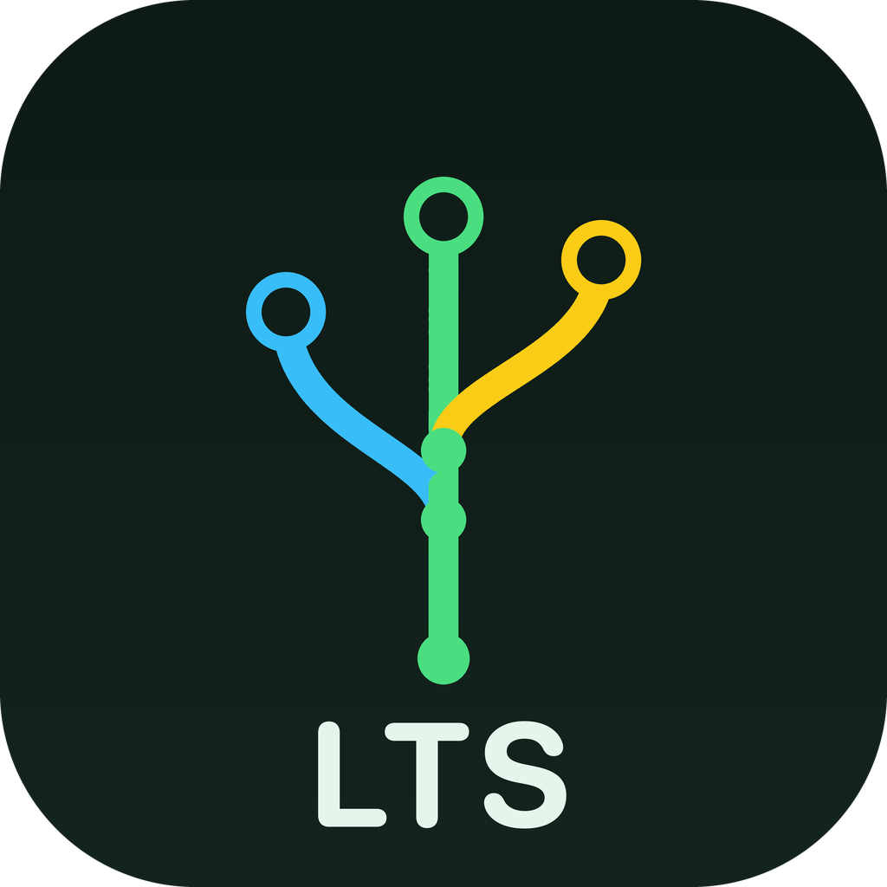
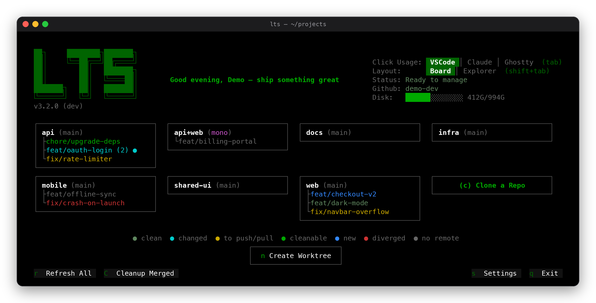
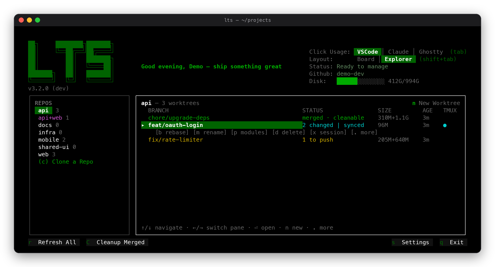
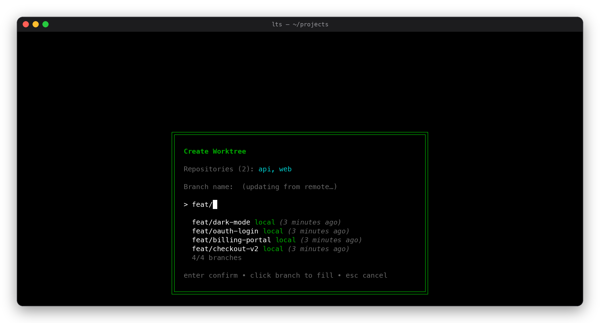
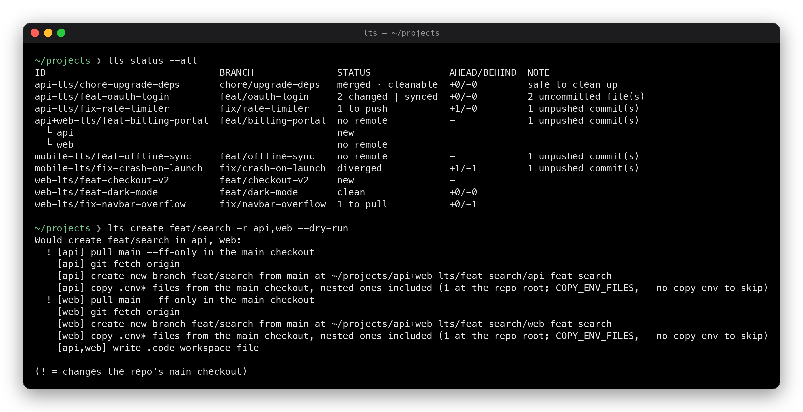
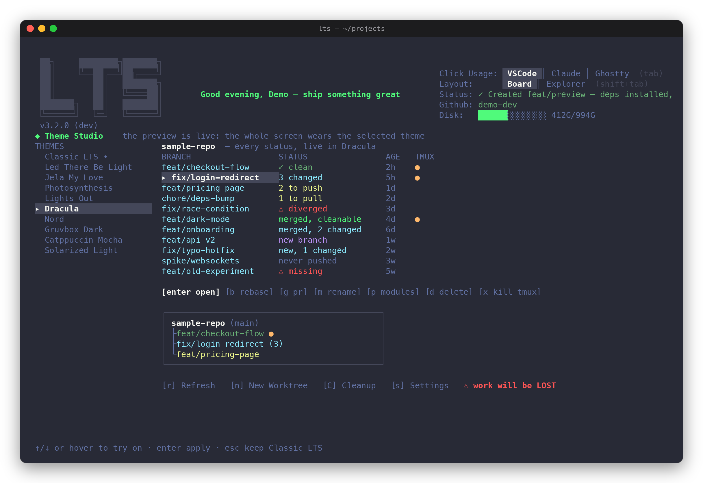

<div align="center">



# LTS

**Git worktrees for every repo in your workspace — one TUI for you, one CLI for your agents.**




</div>

## Features

<table>
<tr>
<td width="33%" valign="top">

### 🌳 One-step worktrees
Pick a repo and a branch; LTS fetches, branches, copies `.env` files, installs dependencies, runs your setup script and writes a workspace file.

</td>
<td width="33%" valign="top">

### 🔗 Mono groups
One branch across several repos (`api + web`), each on its own basis branch and package manager, opened as one workspace.

</td>
<td width="33%" valign="top">

### 🚦 Status at a glance
Clean, changed, to push, to pull, diverged, merged, new: every worktree is color-coded, with the risk of deleting it spelled out.

</td>
</tr>
<tr>
<td valign="top">

### 🖱️ Click to open
Open any worktree in your IDE, AI CLI or terminal. With tmux, each worktree keeps a persistent session that survives closing the window.

</td>
<td valign="top">

### 🤖 Built for agents
A scriptable CLI with `--json` everywhere, stable exit codes, `--dry-run` and no prompts without a TTY, plus a Claude Code plugin with skills and hooks.

</td>
<td valign="top">

### 🔒 Human + agent, safely
The TUI and the CLI share per-repo locks: neither can change a repo the other is working on. `lts watch` streams events for orchestrators.

</td>
</tr>
<tr>
<td valign="top">

### 🛡️ Guarded cleanup
Merged worktrees clean up in one key. Deletes that would lose unpushed or uncommitted work need an explicit `--force`, and protected branches are never deleted.

</td>
<td valign="top">

### 🐙 GitHub built in
Browse and clone any repo you can access, open the PR for a branch, and hibernate old repos after an audit proves GitHub has everything.

</td>
<td valign="top">

### 🎨 Yours to tune
Board or Explorer layout, ten themes with a live Theme Studio, auto refresh and maintenance, and a settings screen for everything.

</td>
</tr>
</table>

## Install

```bash
curl -fsSL https://raw.githubusercontent.com/led-slzr/lts/main/install.sh | bash
```

Downloads a prebuilt binary for macOS or Linux (arm64 / amd64) to `~/.local/bin/lts`, or builds from source when none matches (Go 1.26+). Requires Git. Windows: use [WSL](https://learn.microsoft.com/en-us/windows/wsl/).

## Quick start

```bash
cd ~/projects            # the folder that holds your repos
lts                      # open the TUI (first run walks you through setup)
```

Or drive it from the shell, a script, or an AI agent:

```bash
lts ls                                         # repos and their worktrees
cd "$(lts create feat/login -r api -q)"        # new worktree, then jump in
lts create feat/billing -r api,web             # one branch across two repos
lts status --all                               # what needs attention
lts open feat/login --ide                      # hand it back to your editor
lts cleanup-merged --dry-run                   # preview, then --yes
```

## Gallery

<table>
<tr>
<td width="50%"><p align="center"><sub><b>Explorer</b>: sidebar, worktree table with size, age and tmux</sub></p></td>
<td width="50%"><p align="center"><sub><b>Create</b>: one branch across api + web</sub></p></td>
</tr>
<tr>
<td><p align="center"><sub><b>CLI</b>: status and a dry-run create</sub></p></td>
<td><p align="center"><sub><b>Theme Studio</b>: every status, live in Dracula</sub></p></td>
</tr>
</table>

## Documentation

| Guide | What's inside |
|---|---|
| [Using the TUI](docs/tui.md) | Layouts, keyboard and mouse, click modes, tmux sessions, actions, themes |
| [Command line](docs/cli.md) | Every command, targets, the JSON and exit-code contract, recipes |
| [AI agents](docs/agents.md) | Claude Code plugin, skills, hooks, `lts watch`, orchestration patterns |
| [Configuration](docs/configuration.md) | All settings, per-repo options, workspace layout, environment variables |
| [GitHub integration](docs/github.md) | Clone browser, pull requests, hibernate |

New to LTS from an agent? `lts help agents` is the one-page contract.

## Uninstall

```bash
lts skill uninstall        # if you installed the agent skills
rm -f ~/.local/bin/lts     # the binary
rm -rf ~/.config/lts       # global settings
```

Per workspace, LTS keeps `.lts.conf` and `.lts-locks/` next to your repos.

## License

MIT
