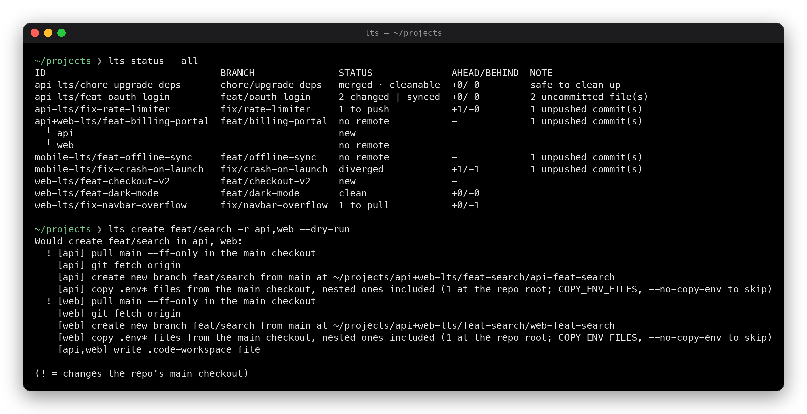

# Command line

Every TUI capability that matters day to day is also a command, built to be safe in scripts and for AI agents that have never seen LTS. `lts help <command>` shows full help with examples and exit codes; `lts help --json` dumps the whole spec.

<p align="center"></p>

- [Where commands run](#where-commands-run)
- [Targets](#targets)
- [The contract](#the-contract)
- [Commands](#commands)
- [Recipes](#recipes)

## Where commands run

The **workspace** is the folder that holds your repos. Commands find it from `--dir`, then `$LTS_DIR`, then the current directory, walking up from inside any repo or worktree, so running from deep in a worktree just works.

```
~/projects/api/                          a repo (main checkout: no branch work here)
~/projects/api-lts/feat-login/           a worktree of api
~/projects/api+web-lts/feat-billing/     a mono group: one branch across api and web
```

## Targets

Commands that act on one worktree accept any of:

| Form | Example |
|---|---|
| branch | `feat/login` |
| folder | `feat-login` |
| id (shown by `lts ls`) | `api-lts/feat-login` |
| path | `./api-lts/feat-login` |
| *(nothing)* | the worktree you are in |

When a branch exists in several repos, add `-r api` (or `-r api,web` for a mono group). Ambiguous targets list every candidate rather than guessing.

## The contract

- **stdout is the result, stderr is progress.** `create`, `path` and `rename` print exactly one path, so `cd "$(lts path feat/x)"` works.
- **`--json` everywhere.** One object on stdout: `{"schema_version":1,"ok":true,…}`, or on failure `{"ok":false,"error":{"code","message","hint","suggestions","available"}}`.
- **No prompts without a terminal** (or with `--no-input`, or when `CI` is set). A missing confirmation exits `4`, and the hint names the flag.
- **Suggestions, never guesses.** Typos come back with the nearest matches (`lts craete` → `create`, `-r apii` → `api`) and are not auto-applied.
- **`--dry-run`** on every command that changes something, including side effects on a repo's main checkout.
- **Shared locks.** A repo another LTS process (the TUI or another command) is changing returns `busy`; add `--wait=2m` to wait instead.

| Exit | Meaning |
|---|---|
| 0 | success |
| 1 | error, including `busy` |
| 2 | usage error |
| 3 | not found or ambiguous (with suggestions) |
| 4 | refused by a safety guard: needs `--yes` / `--force`, or isn't allowed |
| 5 | partial failure (some repos or worktrees failed) |
| 6 | rebase conflict (aborted, changes restored) |
| 7 | already exists (`create --reuse` returns it instead) |
| 130 | interrupted |

Global flags: `--dir`, `--json`, `-q/--quiet`, `--verbose`, `--no-color`, `--no-input`, `--wait[=DUR]`.

## Commands

### Inspect

| Command | |
|---|---|
| `lts ls [repo…]` | repos and their worktrees, including missing ones (fast: no git status). `--hidden` |
| `lts status [target]` | state, ahead/behind, changed files, unpushed commits, delete risk. `--all`, `--fetch`, `-r` |
| `lts path [target]` | the worktree's path and nothing else. `--member <repo>` for one repo of a group |
| `lts watch` | stream events: `worktree_added`, `worktree_removed`, `busy`, `idle`, `missing`; `state_changed` with `--status`. `--json` for NDJSON, `--interval` |
| `lts config [list \| get KEY \| path]` | settings with value, default and source; `-r <repo>` for per-repo keys |

### Create and change

| Command | |
|---|---|
| `lts create <branch> -r <repo>[,<repo>…]` | a worktree, or a mono group for several repos. `--basis BR` or `--basis api=dev,web=main`, `--lts-root DIR`, `--no-install`, `--no-copy-env`, `--copy-mcp`, `--no-setup`, `--open ide\|ai\|terminal`, `--reuse`, `--dry-run` |
| `lts open [target]` | open it like a TUI click: `--ide`, `--ai`, `--terminal` (or `--with MODE`; default = the TUI's click mode). `--member` |
| `lts rebase [target]` | onto the basis branch; a group rebases every member (`--member` for one). `--refresh`, `--no-install`, `--dry-run` |
| `lts rename [target] <new-branch>` | branch, folder, workspace file and tmux session. `--remote`, `--dry-run` |
| `lts refresh [repo…]` | fetch and fast-forward each basis branch. `--due` = only repos past `AUTO_REFRESH`, `--dry-run` |
| `lts pr [target]` | the open PR, or a prefilled compare page; opens a browser on a terminal, prints the URL otherwise. `--print`, `--base`, `--member` |
| `lts config set KEY VALUE` | validated like the Settings screen; `-r <repo>` for per-repo keys, `--dry-run` |

### Remove

| Command | |
|---|---|
| `lts delete [target]` | worktree, workspace file, tmux session and local branch (`--keep-branch` keeps it, `--remote` deletes origin's too). Safe states need `--yes`; uncommitted or unpushed work needs `--force --yes`. Protected branches are never deleted; remote branches holding commits found nowhere else are never deleted. |
| `lts cleanup-merged` | every merged, clean worktree. `--dry-run`, `--yes`, `--remote`, `-r` |
| `lts clean-modules [target]` | remove `node_modules` and report the space freed. `--dry-run` |
| `lts prune [repo…]` | forget worktrees whose folder was deleted by hand (branches are kept). `--dry-run` |
| `lts hibernate <repo>` | the TUI's [Hibernate Repo](github.md#hibernate). `--dry-run`, `--manual`, `--confirm <repo>` |

### Agents and other

| Command | |
|---|---|
| `lts help agents` | the contract for AI agents in one page |
| `lts skill install \| uninstall \| print \| list` | agent skills and hooks ([AI agents](agents.md)) |
| `lts hook <event>` | Claude Code hook handlers |
| `lts completion <shell>` | shell completion (repos and worktrees complete too) |
| `lts tui`, `lts version` | |

## Recipes

```bash
# start a task and jump in (safe to retry)
cd "$(lts create feat/search -r api --reuse -q)"

# preview what create will do to the main checkout
lts create feat/search -r api,web --dry-run

# everything with unsaved work
lts status --all --json | jq -r '.worktrees[] | select(.status.dangerous_to_delete) | .id'

# stay current
lts refresh && lts rebase --refresh

# ship
git push -u origin "$(git branch --show-current)" && lts pr --print

# tidy up
lts cleanup-merged --dry-run && lts cleanup-merged --yes
lts prune

# from cron: refresh repos past AUTO_REFRESH
lts refresh --due -q
```
