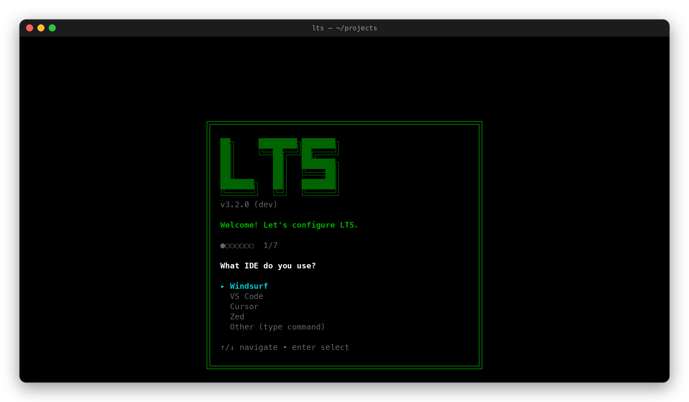
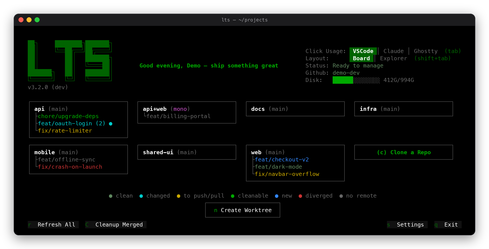
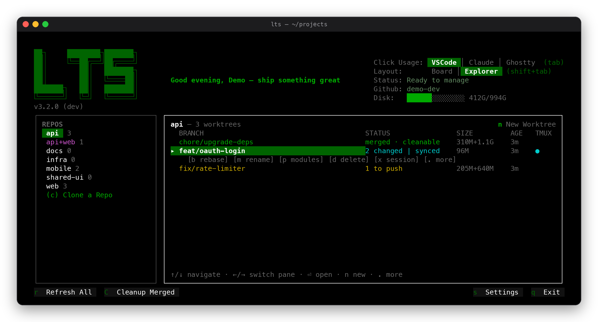
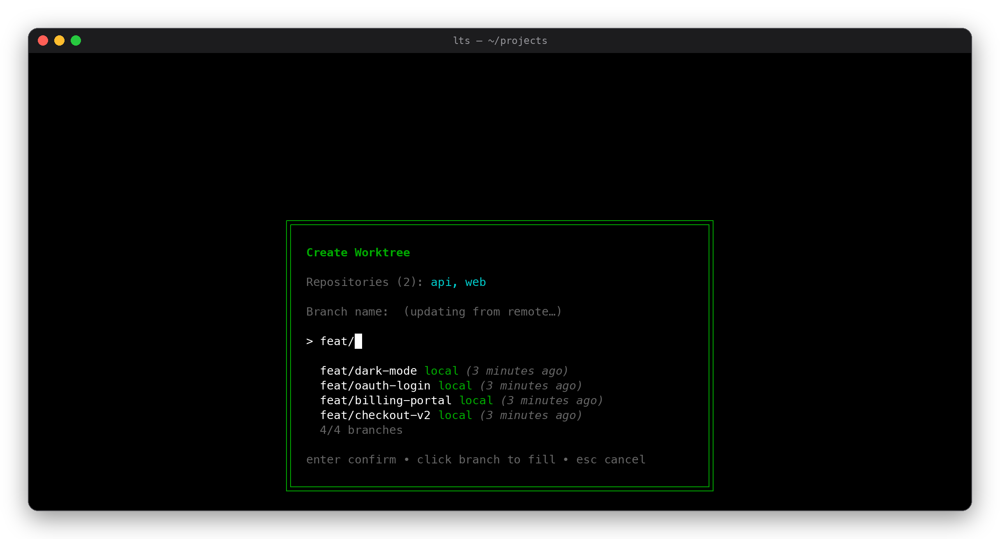
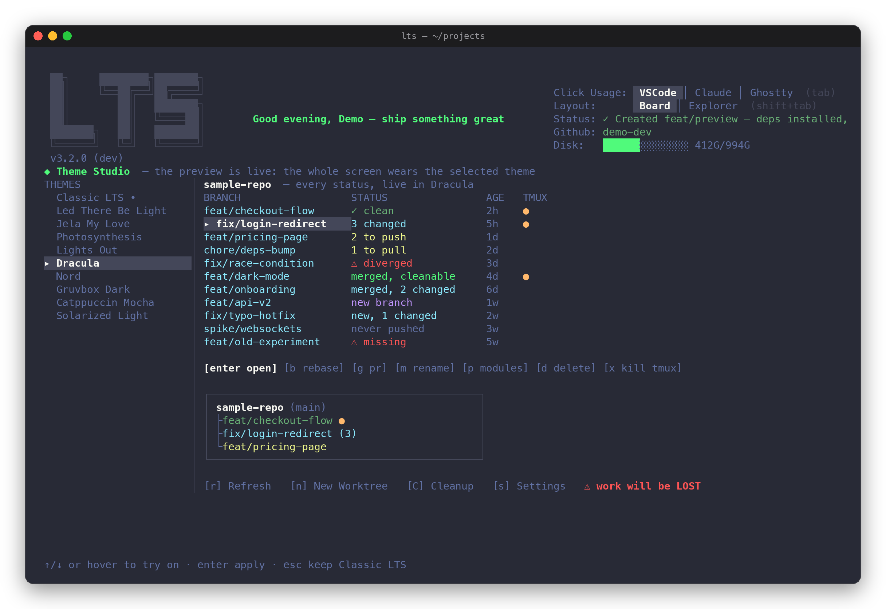

# Using the TUI

Run `lts` in the folder that holds your repos (or `lts --dir ~/projects`). The first launch opens a short setup wizard; everything it asks is editable later in **Settings** (`s`).

- [Layouts](#layouts)
- [Opening worktrees](#opening-worktrees)
- [Creating worktrees](#creating-worktrees)
- [Statuses](#statuses)
- [Actions](#actions)
- [Keyboard](#keyboard) · [Mouse](#mouse)
- [Themes](#themes)
- [Settings](#settings)
- [Working alongside an agent](#working-alongside-an-agent)

## Layouts

Switch with `Shift+Tab` or by clicking **Board / Explorer** in the header; the choice is remembered.

| Board | Explorer |
|---|---|
| A card per repo with its worktrees; mono groups get their own card. | A repo sidebar and a worktree table with full status, size (`code+node_modules`), age and tmux columns, plus an action strip on the selected row. |
|  |  |

The header shows the click mode, layout, status line, GitHub login and a disk gauge (green → yellow → red as the volume fills).

## Opening worktrees

Clicking a worktree (or `Enter` in Explorer) opens it in the current **click mode**, cycled with `Tab`:

| Mode | Opens |
|---|---|
| **IDE** | the worktree's `.code-workspace` file in your IDE (`windsurf`, `code`, `cursor`, `zed`, or any command) |
| **AI CLI** | your AI CLI (`claude`, `opencode`, …) in a new terminal |
| **Terminal** | a shell in a new terminal (Ghostty, iTerm2, Terminal.app, WezTerm, Alacritty, Kitty, or any command) |

**tmux sessions.** Set *Multiplexer* to `tmux` and AI CLI / Terminal opens share one persistent session per worktree: the AI CLI on the left, 1–3 shell panes on the right (width and pane count are configurable). Reopening reattaches, so a conversation survives closing the window; sessions follow renames and are killed on delete. A ● marks worktrees with a live session.

The workspace file LTS writes opens, on folder open, your AI CLI, a package-manager terminal, a git terminal and (optionally) your `.env` files.

## Creating worktrees

Press `n` (Explorer: pre-filled with the selected repo).

1. **Pick repos.** One repo makes `<repo>-lts/<branch>/`; several make a **mono group**, one branch across all of them in `<a>+<b>-lts/<branch>/` with a shared workspace.
2. **Name the branch.** Suggestions list local and remote branches by recency (refreshed from the remote in the background). An existing branch is checked out or tracked; a new one starts from each repo's basis branch.
3. **Confirm.** Review the folders, toggle the dependency install per repo, and go.

Each repo's main checkout is first stashed (if dirty), switched to its basis branch and fast-forwarded. Then LTS fetches, adds the worktree, copies `.env*` (and optionally `.mcp.json`) files, installs dependencies with the detected package manager, and runs the repo's setup script. When it finishes, it offers to open the result.

**Already working in a repo's main folder?** Its card turns yellow with a **Migrate to LTS** button that moves your branch, including uncommitted work, into a worktree and returns the main checkout to its basis branch.

## Statuses

| Color | State | Meaning |
|---|---|---|
| 🟢 | clean | pushed and in sync |
| 🔵 | changed | uncommitted changes (`(2)` = files) |
| 🟡 | to push / to pull | ahead of / behind its remote |
| 🔴 | diverged | ahead *and* behind |
| 🟩 | merged · cleanable | merged into the basis branch (squash/rebase merges included), nothing local; safe to clean up |
| 🔷 | new | branch with no commits yet |
| ⚪ | no remote | commits that were never pushed |
| ⚠️ | missing / unknown | folder gone, or unreadable by git (never treated as safe) |

A mono group shows its riskiest member: it is only *cleanable* when every member is.

## Actions

Open a worktree's menu with its `[▸]` button (Board), `.` (both layouts), or the Explorer action strip.

| Worktree action | |
|---|---|
| Rebase | onto the basis branch; changes are stashed and restored, conflicts abort cleanly. Mono groups rebase every member. |
| Create PR | opens the prefilled GitHub compare page (or the existing PR) |
| Rename Branch | renames the branch, folder, workspace file and tmux session, optionally on the remote too |
| Clean Modules | deletes every `node_modules` and reports the space freed |
| Add to Mono Group / Split Mono Group | turn a worktree into a group (adopting or creating partner worktrees), or split a group back into single worktrees |
| Delete | removes the worktree and, optionally, its local and remote branch. Risky states require typing `DELETE`; protected branches (`main`, `master`, `develop`, `development`, `staging`, `production`, `release/*`) are never deleted. |
| Kill Tmux Session | |

| Repo action | |
|---|---|
| Refresh | fetch and fast-forward the basis branch |
| Change Basis Branch | the branch new worktrees start from and rebase onto |
| Hide / Unhide Repo | keep stray folders (`.nvm`, …) off the board; *Show Hidden Repos* brings them back greyed out |
| Hibernate Repo | delete the local copy after an audit proves GitHub has everything (see [GitHub](github.md#hibernate)) |

Footer actions: **Refresh All** (`r`), **Cleanup Merged** (`Shift+C`: removes every merged, clean worktree), **Settings** (`s`), **Exit** (`q`).

## Keyboard

| Key | Action |
|---|---|
| `Tab` | cycle click mode: IDE → AI CLI → Terminal |
| `Shift+Tab` | switch layout |
| `↑↓←→` / `hjkl` | move (Explorer: `←/→` switch between sidebar and table) |
| `Enter` | open the selected worktree |
| `.` | full action menu for the selection |
| `n` | create worktree |
| `b` `g` `m` `p` `d` `x` | Explorer row: rebase, PR, rename, clean modules, delete, kill tmux |
| `c` | clone a repo from GitHub |
| `r` | refresh all repos |
| `Shift+C` | cleanup merged worktrees |
| `l` | clear the log panel |
| `s` | settings |
| `Esc` | close / back |
| `q`, `Ctrl+C` | quit |

## Mouse

Everything is clickable: hover highlights cards and rows, a click opens a worktree in the current mode, `[▸]` opens its menu, and the header switches click mode and layout. The scroll wheel scrolls the board, the log panel and settings.

## Themes

Ten themes: Classic LTS, Led There Be Light, Jela My Love, Photosynthesis, Lights Out, Dracula, Nord, Gruvbox Dark, Catppuccin Mocha and Solarized Light. Open **Settings → Preferences → Theme** and browse: the whole screen re-skins live, with a sample repo showing every status.

## Settings

`s` opens four tabs: **Preferences** (tools, workflow, appearance, features), **Workspace** (what new worktrees get), **Worktrees** (per-repo basis branch, package manager, setup script) and **Diagnostics** (installed tools, package managers, gh, tmux, build info, update check, reset). A ⚠ appears next to any tool that isn't installed. Every setting is listed in [Configuration](configuration.md).

**Background care**, all opt-in:
- **Auto Refresh** refreshes repos past an interval.
- **Auto Clean Modules** removes `node_modules` from idle worktrees.
- **Auto Kill Tmux** ends idle sessions.

Busy repos are always skipped.

## Working alongside an agent

The TUI and the [CLI](cli.md) take the same per-repo locks. While an agent's `lts` command works on `api`, the TUI refuses actions there and names the holder ("api is busy (pid 4211: lts delete feat/x) — try again when it finishes"), and the agent gets `busy` while you work on it. Repos busy elsewhere show as busy cards.
